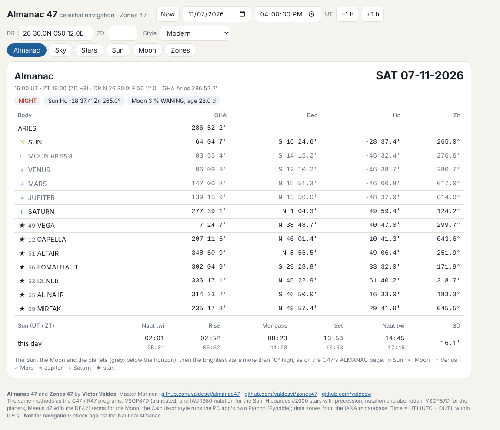
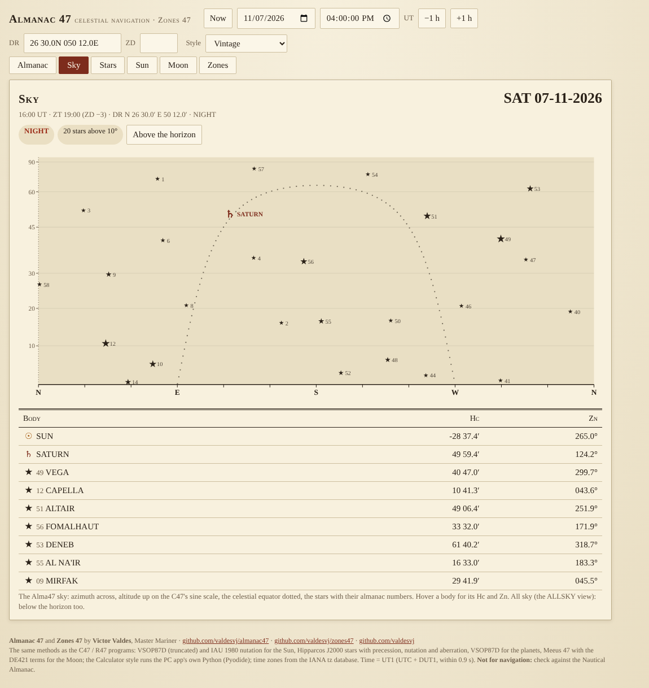
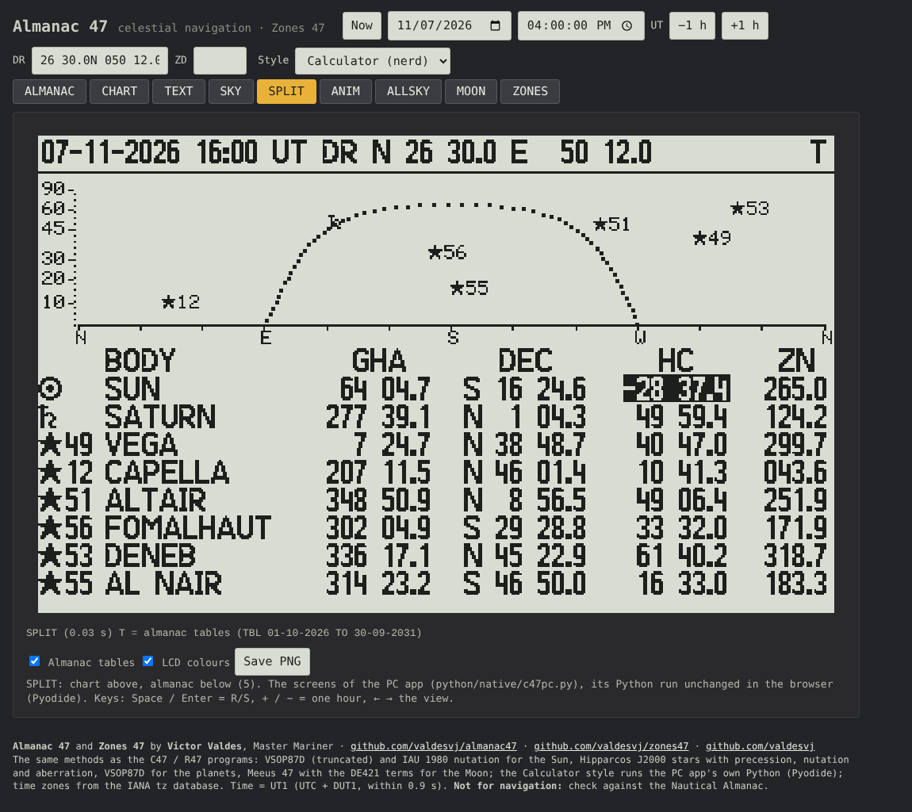

# Almanac 47 and Zones 47 on the web

The Python reference of Almanac 47 (`python/nav.py`, `python/moon47.py`) in JavaScript (`nav.js`, line for line, the
same coefficients), with a one-page app, plus Zones 47's world time zones (github.com/valdesvj/zones47).

Three **styles** (the Style menu at the top, remembered):

| Style | |
|---|---|
| **Modern** | the tabs below, with the symbols ☉ Sun, ☾ Moon, ♀ Venus, ♂ Mars, ♃ Jupiter, ♄ Saturn, ★ star |
| **Vintage** | the same, as the printed almanac: paper, ink, serif, ruled tables |
| **Calculator (nerd)** | the C47 screens of the PC app (`python/native/c47pc.py`) pixel for pixel: ALMANAC CHART TEXT SKY SPLIT ANIM ALLSKY MOON, R/S (Space / Enter), Play for SKY's names and ANIM's frames, the almanac tables (TBL_5) on or off, LCD colours, Save PNG / TEXT |





### The Calculator style: Python in the browser

It does not copy the screens in JavaScript: it runs the PC app's own Python, unchanged (`web/data/pysrc.js` =
`python/native/c47*.py` and `python/moon47.py`; `web/data/tbl.js` = `build/TBL_5.txt`), in Pyodide (CPython in
WebAssembly), so every screen is the one `c47pc.py --png` writes. The first time, the app **asks before downloading
Python** (Pyodide 0.26.4, about 10 MB, from cdn.jsdelivr.net; Yes, or No back to Modern; the browser keeps it). Modern
and Vintage need nothing from the internet.

Offline (a ship without internet): put Pyodide in `web/pyodide/` (git-ignored) and serve the folder:
```bash
cd ~/opt/almanac47
npm pack pyodide@0.26.4 && tar xzf pyodide-0.26.4.tgz && rm -rf web/pyodide && mv package web/pyodide && rm pyodide-0.26.4.tgz
python3 -m http.server 8047 -d web        # then http://localhost:8047
```
(Opened as a file, Chrome does not let a page read files next to it, so the local copy needs the small server.)

## Run it

```bash
cd ~/opt/almanac47
google-chrome web/index.html          # or chromium / google-chrome-stable; it works as a file, no server needed
```
For a phone on the same network: `python3 -m http.server 8047 -d ~/opt/almanac47/web`, then `http://<the computer's
address>:8047`.

| Tab | |
|---|---|
| **Almanac** | the C47's ALMANAC page (ALMF): GHA Aries; the Sun, the Moon (HP), Venus, Mars, Jupiter, Saturn (grey below the horizon) and the brightest stars more than 10° high, GHA, Dec, Hc, Zn; nautical twilight, rise, meridian passage, set (UT and ZT, or LT and UT), the Sun's SD; DAY / TWILIGHT / NIGHT; the Moon |
| **Sky** | the Alma47 sky (the C47's CHART / SKY): azimuth across N E S W N (S W N E S south of the equator), altitude up on the sine scale (10 20 30 45 60 90), the celestial equator dotted, the Sun, the Moon, the planets with their symbols, the 58 stars ★ with their numbers; **All sky** (ALLSKY): below the horizon too; **Dome**: the sky from the DR with the zenith in the centre, north up, the stars by brightness, the Moon and the planets; the bodies of the ALMANAC page with Hc and Zn |
| **Stars** | the 57 navigational stars and Polaris: SHA, GHA, Dec, Hc, Zn, brightness; sortable |
| **Sun** | GHA, Dec, SD, Hc, Zn now; the day's twilights, rise, meridian passage and set in UT and ZT |
| **Moon** | MOON47: the disc (northern or southern view), lit %, age, HP, SD, the next four phases in UT and ZT |
| **Zones** | ZONE47: the dot map in 24 columns of 15°, the 38 stops (the official offsets, −12 at sea), every stop's places with their local time and summer time now; your zone ▲; ← → the stop, ↑ ↓ the place |

The top: **Now** follows the clock (UT from the computer), or a date and a UT; ±1 h; the **DR** (`27 12.0N 049
42.0E` or `27.2 49.7`) and the **ZD** (zone description: ZT + ZD = UT; empty: from the DR's longitude). Keys: + / −
one hour. **Times UT / LT** (the button, or key L): every time shown in UT first (ZT under it), or in local time
first, LT = ZT = UT − ZD (UT under it): the date of the header, the Sun's events, the Moon's phases and, in the
Calculator style, the C47 screens as the calculator's +/- switch shows them. The date and time you type stay UT.

## Data

`python3 tools/make_web_data.py [--zones ~/opt/zones47]` writes `web/data/navdata.js` from `python/navdata.py`,
`web/data/astro.js` (the planets and the Moon) from `python/native/c47data.py`, `web/data/pysrc.js` and `web/data/tbl.js`
(the Calculator style's Python and tables), and `web/data/zones.js` from a Zones 47 checkout (its `python/zones.py`, IANA tzdata, and `python/worldmap.py`). The
places' local times and summer time come from the browser's own tz database (Intl), so they follow the rules in force.

## Checked

`python3 tests/test_web.py` (node): 150 random dates 1950-2100 and places against the Python: the Sun, the 58 stars
(1E-11°), 1050 events (1E-8 s), Hc / Zn, the ALMANAC page's text (the same, character for character), MOON47, and the
Moon and the planets against `python/native/c47astro.py` (1E-10°).

`python3 tests/test_web_calc.py` (Chromium, needs `web/pyodide/`): the Calculator style's canvas against
`c47pc.py --png` for 3 dates and places (north, south, west) and 7 views: 21 / 21 identical, pixel for pixel.

Not for navigation: check against the Nautical Almanac. By Victor Valdes, Master Mariner:
https://github.com/valdesvj/almanac47 and https://github.com/valdesvj/zones47
